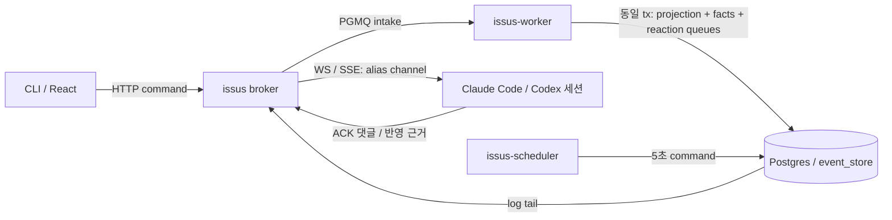

# 구조

루트 compose 하나와 서비스 모듈4개를 사용한다.

| 서비스 | 소유 모듈 | 실행·저장 |
| --- | --- | --- |
| `issus-db` | `apps/issus-db` | PostgreSQL18+PGMQ, named issus_pgdata, loopback15440→5432 |
| `issus` | `apps/issus` | Express HTTP·WS/SSE·Vite React dist, loopback18140 |
| `issus-worker` | `apps/issus-worker` | intake·route·delivery·compact 큐, 내부 health |
| `issus-scheduler` | `apps/issus-scheduler` |5초 tick producer+schedule 소비, 내부 health |

`issus_internal`은 프로젝트 bridge이며 `internal:false`다(DECISION6308921916). 다른 프로젝트 external network는 연결하지 않는다. Dockerfile은 호스트에서 만든 target=node24 self-contained dist를 COPY하며 설치·빌드를 하지 않는다. 배포 진입점은 `npm run deploy`다.

`packages/agent`는 event store·PGMQ·lease·hub·worker frame을 vendor한다. `issus_domain`은 규약/도메인, `issus_runtime`은 인증/migration/binding이다. 라이브러리는 앱을 import하지 않고 교차 패키지는 workspace 공개 export를 사용한다. React는 `apps/issus/src/front`, 환경 독립 client/model은 `issus_domain/front`다.

broker entry는 extendHttp에서 core·inbox·compact·SSE 라우터를 static fallback보다 먼저 연결하고 reaction table·큐 mapper를 공유한다. 실제 조립 시험은 [acceptance-harness](../apps/issus/tests/integration/acceptance-harness.mjs)다. [vendoring](vendoring.md), [내부](internals.md), [설계 §9](design.md#9-모노레포-구조빌드운영)를 따른다.
